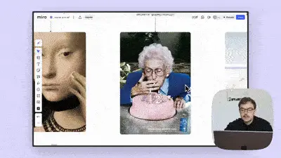

Currently, courses are [available in Ukrainian](/ua/courses), and English versions will be added soon.

### [Як створювати зображення зі ШІ?](/ua/courses/how-to-create-images-with-ai)

[Практичний онлайн-курс, який навчить вас генерувати якісні візуали для бізнесу, навчання чи творчості — швидко, просто і без досвіду в дизайні.](/ua/courses/how-to-create-images-with-ai)

[3 години](/ua/courses/how-to-create-images-with-ai)

### [How to Start on OnlyFans](/ua/courses/onlyfans)

[A practical online course on earning money by selling content on OnlyFans. It offers step-by-step lessons, real examples, and strategies to turn your idea into income.](/ua/courses/onlyfans)

[3 hours](/ua/courses/onlyfans)

### [ChatGPT 101](/ua/courses/chatgpt)

[We navigate the hype and learn to use ChatGPT in daily life and work. For those who spend their days on screens but want to reclaim time and focus on what matters.](/ua/courses/chatgpt)

[2 hours](/ua/courses/chatgpt)

### [Individual Consultation](/courses/consultation)

[I help with monetization strategies, creating engaging educational content and solving technical issues.](/courses/consultation)

[1 hour](/courses/consultation)

