Практичний онлайн-курс, який навчить вас генерувати якісні візуали для бізнесу, навчання чи творчості — швидко, просто і без досвіду в дизайні.

[Приєднатися](#cta)

[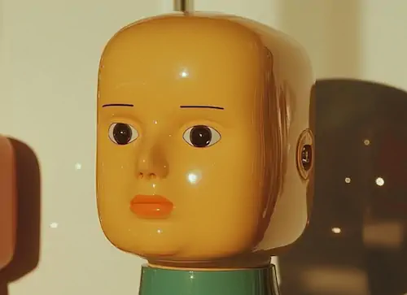](#)

[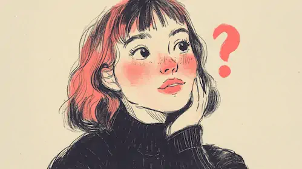](#)

[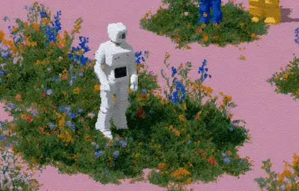](#)

[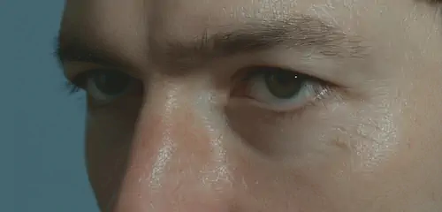](#)

[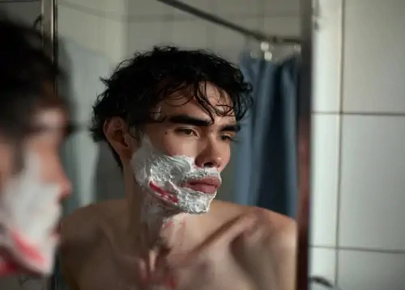](#)

[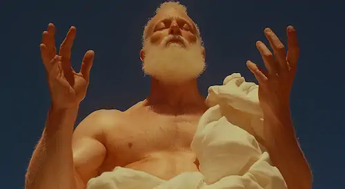](#)

[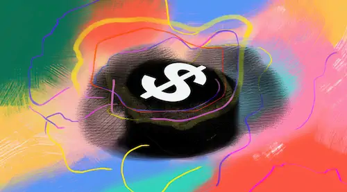](#)

[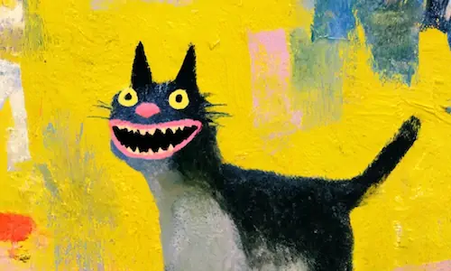](#)

[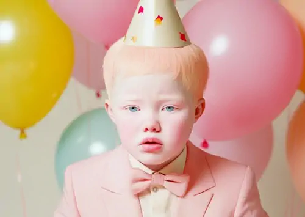](#)

[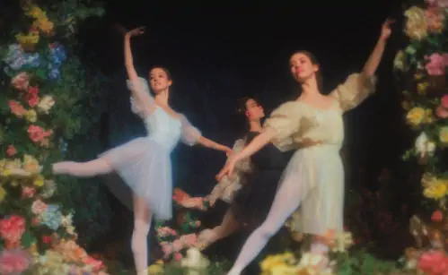](#)

[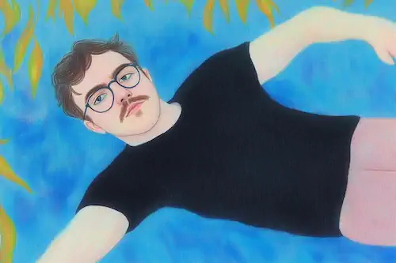](#)

[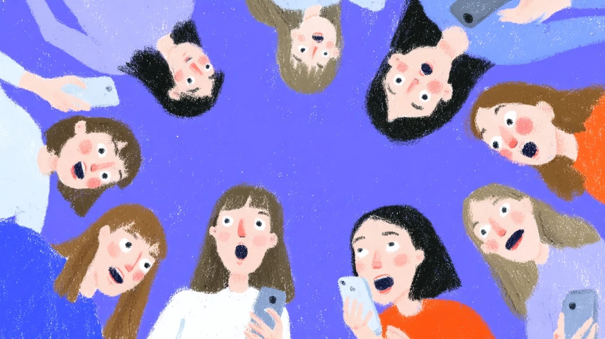](#)

[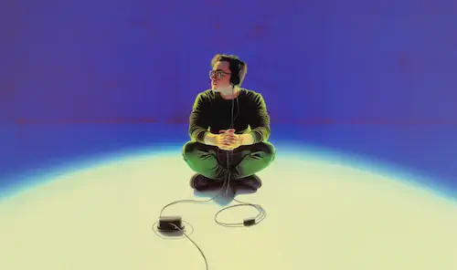](#)

## Для кого цей курс?

Курс підходить для маркетологів, підприємців, викладачів та всіх, хто хоче створювати яскраві зображення за допомогою ChatGPT та Midjourney.

1

###### Для маркетологів та дизайнерів

Створюйте креативи, мокапи, іконки та варіанти дизайну за хвилини й одразу тестуйте ідеї перед запуском реклами або лендингу. ШІ-інструменти замінять довгі брифи та скоротять час на погодження.

###### Для кріейторів та підприємців

Візуалізуйте будь-яку ідею — від шапки YouTube-каналу до лукбуку для бренду одягу чи обкладинки книги. Якісний візуал без найму окремого дизайнера дозволить швидше презентувати продукт і зекономити бюджет.

2

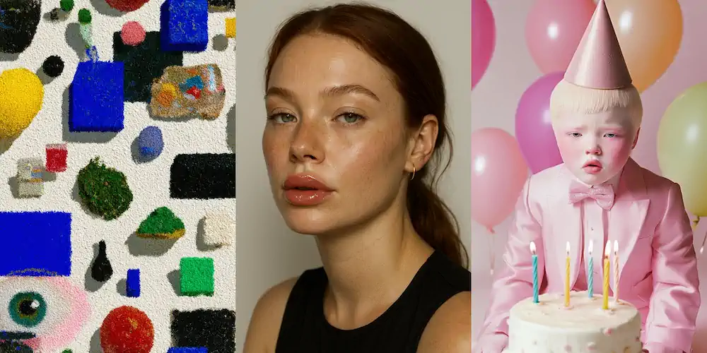

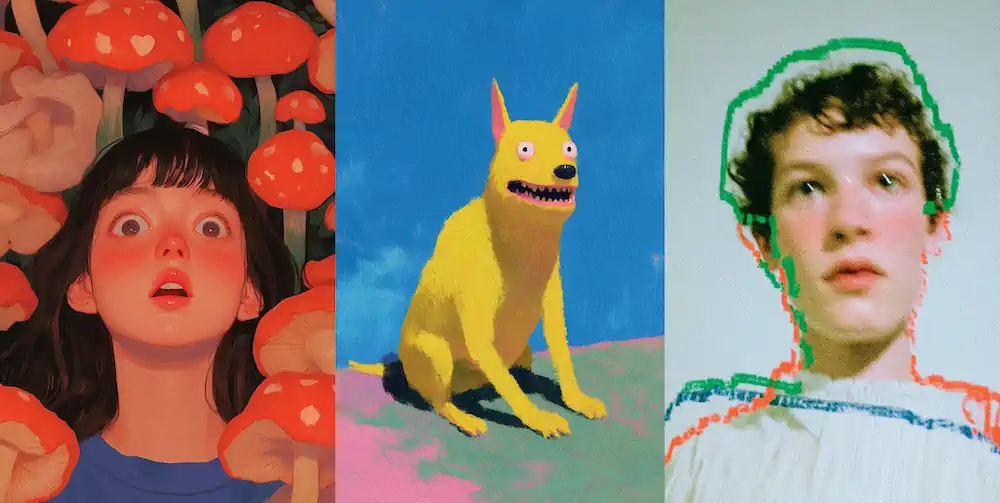

3

###### Для викладачів та експертів

Швидко оформлюйте слайди, чек-листи, PDF та обкладинки до курсів. Генеруйте персонажів і сцени, які роблять складні теми простішими й додають авторським матеріалам впізнаваного стилю.

###### І всіх, хто любить експерименти

Працювати зі штучним інтелектом весело і цікаво. Навчіться перетворювати ідеї на яскраві картинки та використовуйте цю навичку в роботі, навчанні чи хобі.

4

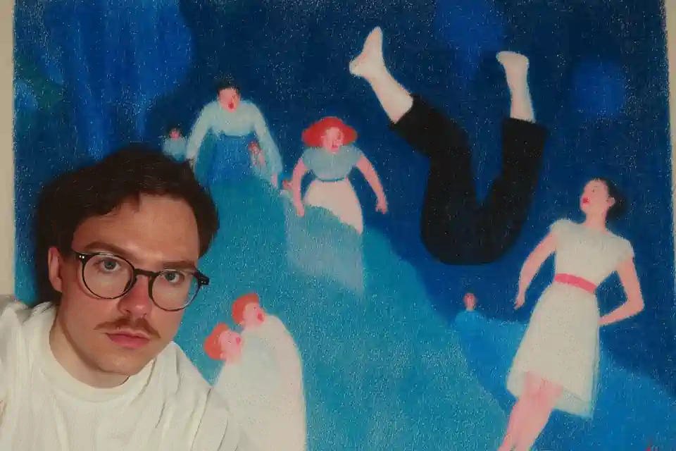

оновлено 29 травня

## Що всередині?

Актуальні уроки з генерації зображень у ChatGPT та Midjourney — оновлено 30 травня 2025 року.

Чому ідеї важливіші за візуал?

Розберемо, чому ідеї та креативні метафори важливіші за технічну якість візуалу та як використовувати методи генерації ідей (SCAMPER, 5 Ws)

9 хвилин

Як працювати з референами?

Навчимося збирати референси й мудборди з різних джерел та підбирати оптимальний інструмент для генерації зображень

13 хвилин

Як будувати промпти?

Створюватимемо ефективні промпти — простою мовою, за допомогою шаблонів, голосом, а також на основі інших зображень чи скетчів

37 хвилин

Як працювати зі стилем?

Детально розберемо способи стилізації, використання референсів, персоналізацію та ретекстурування готових ілюстрацій

42 хвилини

Як редагувати зображення?

Зосередимось на ітераціях і редагуванні згенерованих зображень: розберемо версії моделей, естетичні налаштування, послідовні персонажі та точкові зміни

36 хвилин

Як експортувати?

На фінальному етапі навчимося експортувати та рендерити зображення у високій якості і розглянемо зовнішні інструменти для підвищення якості зображень

9 хвилин

The #1 online courses

## Як почати?

Доступні два формати: самостійне проходження або з індивідуальним супроводом.

###### Онлайн-курс

Миттєвий доступ до всіх уроків, промптів і інтерактивної презентації в Telegram-боті одразу після оплати.

[Безкоштовно на YouTube](https://www.youtube.com/playlist?list=PL5hTRmGvPv7iERSGzUevzLy3cAtWpcZJ2)

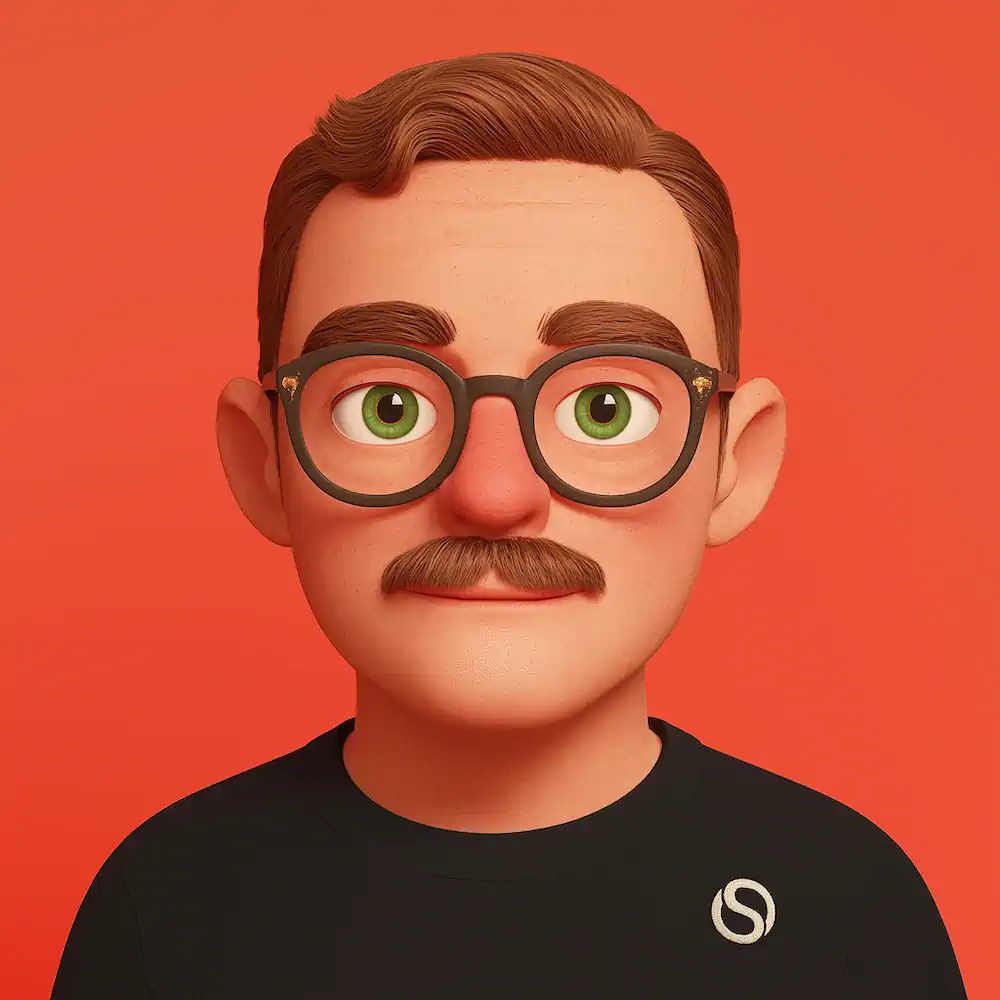

###### Онлайн-курс + супровід

Окрім курсу — два індивідуальні дзвінки: перед стартом і після завершення, щоб підібрати рішення саме під ваші завдання. Доступно 3 місця.

[Придбати за 5000 гривень](https://secure.wayforpay.com/payment/s53b8b1b3d26d)

## Є питання?

[Чи потрібен досвід роботи для участі в курсі?](#)

Ні, ми почнемо з основ, тож вам не потрібні жодні спеціальні знання.

[Які конкретні навички я отримаю після проходження курсу?](#)

Після проходження курсу ви зможете генерувати зображення будь-якої складності та в різних стилях — від фотореалістичних до ілюстративних.

[Чим цей курс відрізняється від безкоштовних матеріалів у мережі?](#)

У цьому курсі ви знайдете структуровані уроки з реальними прикладами. Матеріали створено на основі мого трьохрічного досвіду роботи. Я ділився лише тим, що дійсно працює, щоб ви не витрачали зайвий час.

[Чи можна буде повернути гроші?](#)

Звісно, ви можете повернути кошти протягом 14 днів без зайвих запитань. Для цього [напишіть мені](/ua/contacts), вказавши номер телефону, який ви використовували при оплаті.

[Чи можна розбити оплату на декілька платежів?](#)

Так, ви можете використати оплату частинами від monobank, або ПриватБанк. Для цього на сторінці оплати оберіть «У розстрочку». Також ви можете оплатити готівкою через термінали ПриватБанку.

[Чи можна оплатити іншим способом?](#)

Так, можна оплатити через PayPal, Payoneer, Wise, Payeer та криптовалюти. Реквізити можете [знайти тут](/ua/courses/payment-alternatives).

[Задати питання](/ua/contacts)
