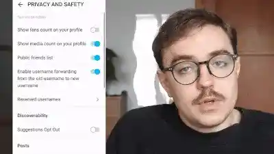
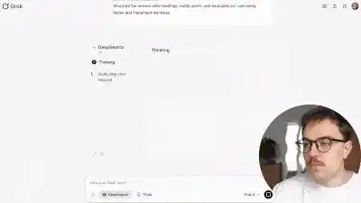
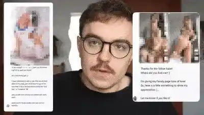
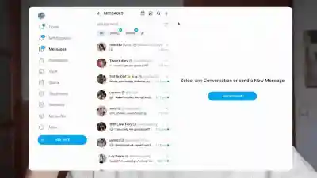
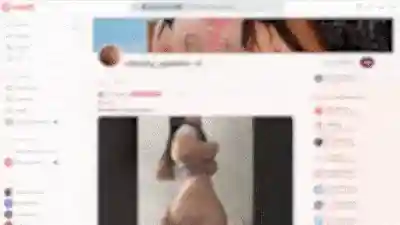
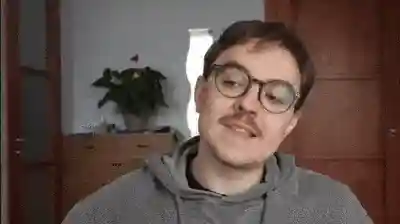

Практичний онлайн-курс з прикладами та покроковими уроками, який допоможе вам перейти від ідеї до перших зароблених грошей.

Ви дізнаєтеся, кому підійде такий формат роботи, на чому конкретно заробляються гроші та як знайти платоспроможних підписників.

Нижче наведено [детальний список уроків](#lessons).

<Shot src="./6818c0ff2aec7fc250558198_onlyfans1.webp" alt="Курс по заробітку на OnlyFans" />

Свіжа статистика однієї з моделей, яка одразу після проходження курсу змогла вийти на понад 100 доларів на день, витрачаючи лише кілька годин щодня.

Хороший старт, і зростання триває.

<Callout>
  Курс підходить для будь-якої платформи продажу adult-контенту ([OnlyFans](/ua/monetize/memberships/onlyfans), [Fansly](/ua/monetize/memberships/fansly), [Fanvue](/ua/monetize/memberships/fanvue), [Patreon](/ua/monetize/memberships/patreon) тощо) і допоможе підібрати оптимальну саме для вас.
</Callout>

## Для кого цей курс?

Буде корисно, якщо:

### Не знаєте, з чого почати

Чули, що на OnlyFans багато грошей, але не зовсім розумієте, за що їх платять і з чого почати роботу.

### Спробували, але не вийшло

Створили акаунт, але не знайшли підписників або не зрозуміли, як їх ефективно монетизувати.

### Хвилюєтесь за безпеку

Не хочете, щоб знайомі побачили ваш профіль, або не знаєте, який контент можна створювати, а який ні.

Після курси ви зрозумієте:

### Чи підійде вам такий формат

Розберемося, що популярне, і як створювати контент, за який не соромно.

### Який контент треба робити

Навчимося виділятися, розкриваючи свою особистість, а не просто публікуючи гарні фото.

### Як знайти підписників

Просто створити профіль недостатньо – його не знайдуть. Навчимося залучати підписників, готових платити саме вам.

## Про що будемо говорити?

Список уроків:

### Формат роботи та очікування

Познайомимось з курсом, його метою — навчитися заробляти на платформах монетизації контенту, і визначимо, кому підходить такий формат роботи.

21 хв

### Легальність та безпека

Розглянемо легальність роботи на платформах типу OnlyFans в Україні, аспекти розповсюдження контенту та оподаткування доходів.

19 хв

### Вибір ніші та аналіз конкурентів

Оберемо нішу та створимо унікальну історію для вашого профілю, проводячи дослідження та аналіз прикладів контенту.

32 хв

### Оформленяя профілю

Розберемось з оформленням профілю: аватарка, обкладинка, ім'я та опис, що привернуть увагу саме вашої аудиторії.

15 хв

### Як визначити ціни

Визначемо стратегії ціноутворення на підписку та контент, проаналізуємо переваги безкоштовних і платних акаунтів для максимізації заробітків.

16 хв

### Як створювати контент

Поговоримо про створення якісного контенту, визначимо оптимальну частоту публікацій, знайдемо нові ідеї та надихнемось успішними прикладами.

37 хв

### Як розкрутити аккаунт

Розберемо стратегії просування через соцмережі та спеціалізовані сайти для залучення трафіку та платоспроможних підписників.

42 хв

### Як спілкуватись з підписниками

Опануємо ефективну комунікацію через масові розсилки та індивідуальні повідомлення, встановимо особисті кордони для комфортної роботи.

15 хв

## Хто веде курс?

Привіт, я [Олександр Слободський](/ua).

Допомагаю кріейторам заробляти вже понад 10 років, а з OnlyFans працюю останні 4 роки.

Завдяки моїй [безкоштовній статті про OnlyFans](/ua/monetize/memberships/onlyfans) тисячі авторів зареєструвалися на платформі та заробили понад $1M (_точну суму знаю, бо отримую відсоток через партнерську програму_).

Трошки робочих моментів можна [підгледіти в Instagram](https://www.instagram.com/slobodskyi/).

Декілька прикладів:

### Приклади з життя

Крім статті, до мене часто [звертаються за консультаціями](/ua/courses/consultation), а з деякими авторами ми співпрацюємо на довгостроковій основі.

Один з найуспішніших кейсів — пара, яка вже на третій місяць досягла $10K+, активно публікуючи доволі відвертий контент і розкручуючи соціальні мережі.

Це чудовий результат, хоча зазвичай до таких цифр потрібно більше часу.

<Shot src="./67de819a107d9f4286bc3bf9_66aa4e7967b11b7892bff6e6_662e376a46685eb43ee9ac96_onlyfans-statistic.webp" alt="Статистика скільки можна заробити на OnlyFans" />

У кожної платформи свої особливості, але принципи оформлення профілю, створення контенту та спілкування з аудиторією – однакові.

<Shot src="./67de81a8e7a053c01e405d6c_66bf703bab705902be36f376_6683e2599c031a494f3bb408_how-much-you-can-earn-fansly.webp" alt="Статистика скільки можна заробити на Fansly" wide />

**В курсі зібрано мій практичний досвід за останні 4 роки – все, що дійсно працює і приносить результати тут і зараз.**

У ніші adult-контенту дійсно багато грошей, але ваш дохід залежить від якості контенту, способу розкрутки та комунікації з аудиторією.

Курс дасть розуміння всіх процесів, відповість на головні питання та допоможе визначити, що зробити сьогодні, щоб вже завтра заробити перші гроші.

Але скільки їх буде – залежить від вас.

<Callout>
  Я поділюсь покроковим планом для моделей, які бажають працювати самостійно, етично та безпечно.
</Callout>

## Як проходить навчання?

Корисно, ефективно, швидко.

Обіцяю прості кроки, практичні приклади та дружню атмосферу.

Після оплати миттєвий доступ до Telegram-бота з уроками.

Можливість задати питання по матеріалам курсу.

Практичні завдання для закріплення знань та бібліотека промтів.

Пожиттєвий доступ і оновлення курсу без доплат.

## Як почати?

<VideoAsk id="fyojrsapl" />

## Часті запитання

### Чи можна розбити оплату на декілька платежів?

Так, ви можете використати оплату частинами від [monobank](https://slobo.click/monobank), або ПриватБанк. Для цього на сторінці оплати оберіть «_У розстрочку_». Також ви можете оплатити готівкою через термінали ПриватБанку.

### Чи можна оплатити іншим способом?

Так, можна оплатити через PayPal, Payoneer, Wise, Payeer та криптовалюти. Реквізити можете [знайти тут](/ua/courses/payment-alternatives).

### Чи потрібен досвід роботи для участі в курсі?

Ні, курс розроблений для новачків. Ми почнемо з основ, тож вам не потрібні жодні спеціальні знання.

### Які конкретні навички я отримаю після проходження курсу?

Ви дізнаєтеся, як почати працювати на платформах для продажу контенту, а також які кроки потрібно зробити, щоб перетворити ідею на перші зароблені гроші. Вище наведено [детальний опис уроків](#lessons).

### Чим цей курс відрізняється від безкоштовних матеріалів у мережі?

У цьому курсі ви знайдете структуровані уроки з практичними чек-листами та реальними прикладами. Матеріали створено на основі мого чотирирічного досвіду роботи. Я ділився лише тим, що дійсно працює, щоб ви не витрачали зайвий час.

### Чи є гарантії результату після курсу?

Пройшовши всі уроки та виконавши завдання, ви здобудете практичні навички і дізнаєтеся, як заробляти на продажу контенту. Якщо курс не виправдає очікувань, ви зможете повернути кошти.

### Чи можна буде повернути гроші?

Звісно, ви можете повернути кошти протягом 14 днів без зайвих запитань. Для цього [напишить мені](/ua/contacts), вказавши номер телефону, який ви використовували при оплаті, та приблизну дату транзакції.

## Реквізити

Фізична особа-підприємець:

### Слободський Олександр Миколайович

Індивідуальний податковий номер:

### 3432501553

Юридична адреса:

### Георгіївський провулок 7, Київ, 01054

Електронна пошта:

### oleksandr\@slobodskyi.com

Банк (_Універсал Банк, МФО: 322001_):

#### IBAN: UA963220010000026009300008485

[Публічна оферта](/ua/courses/public-offer)[Політика конфіденційності](/ua/courses/privacy-policy)

[Приєднатися](#cta)
